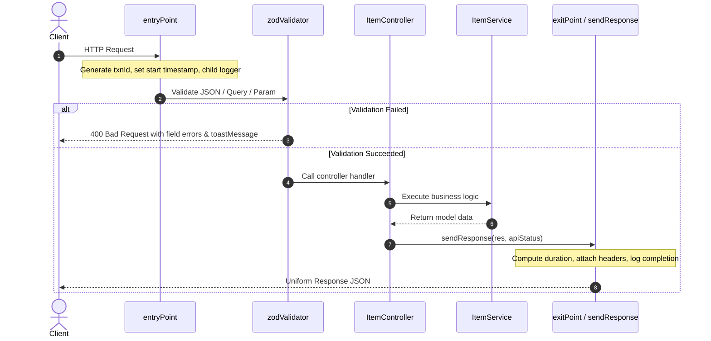

# Express Enterprise CRUD REST API

A production-grade REST API built using **Express.js**, **TypeScript**, and **Node.js**, designed by analyzing and adopting the enterprise architecture, middleware pipeline, and code patterns from the reference architecture.

---

## 📑 Table of Contents

1. [Architecture Overview & Flow Analysis](#architecture-overview--flow-analysis)
2. [What is Husky & Git Hooks?](#what-is-husky--git-hooks)
3. [CRUD REST API Endpoints](#crud-rest-api-endpoints)
4. [Request / Response Lifecycle](#request--response-lifecycle)
5. [Error Handling & Validation](#error-handling--validation)
6. [Interactive API Documentation](#interactive-api-documentation)
7. [Postman Collection & Testing](#postman-collection--testing)
8. [Running the Project](#running-the-project)

---

## 🏛 Architecture Overview & Flow Analysis

The project implements modern enterprise design patterns with clear separation of concerns:

```
Request ➡️ entryPoint ➡️ attachLogger ➡️ Route / ZodValidator ➡️ Controller ➡️ Service Layer ➡️ exitPoint ➡️ Response
```

### 1. Layered Folder Structure
```
c:\Exelon\crud_using_express\
├── .husky/                   # Git hooks (pre-commit & pre-push automation)
│   ├── pre-commit            # Runs lint-staged (ESLint, Prettier, CSpell)
│   └── pre-push              # Verifies TypeScript build (tsc) and full lint
├── src/
│   ├── config/v1/            # Environment and application configuration
│   ├── controller/v1/        # Request handling and response dispatching
│   ├── exceptions/v1/        # Custom exception classes (HttpException)
│   ├── middleware/           # Pipeline middlewares (entryPoint, exitPoint, zodValidator)
│   ├── openapi/              # OpenAPI 3.1.0 specifications
│   ├── routes/v1/            # Route declarations and modular router groups
│   ├── schemas/v1/           # Zod validation schemas
│   ├── services/v1/          # Business logic and in-memory store
│   ├── utils/v1/             # Loggers (Pino), constants, custom types, helpers
│   └── app.ts                # Application bootstrap & server initialization
├── .env                      # Environment variables
├── .env.example              # Template environment variables
├── .prettierrc               # Prettier code formatting rules
├── cspell.json               # Code spell checker dictionary
├── eslint.config.mjs         # ESLint flat config with TypeScript rules
├── package.json              # Dependencies, scripts, and lint-staged config
├── postman_collection.json   # Exported Postman collection for API testing
├── README.md                 # Project documentation
└── tsconfig.json             # TypeScript configuration
```

### 2. Standardized Envelope Response
Every API response strictly follows the uniform reference envelope format:
```json
{
  "status": 200,
  "message": "success",
  "data": { ... },
  "toastMessage": "Operation successful"
}
```

### 3. Traceability Headers
Every response includes correlation and performance tracking headers:
- `X-Transaction-Id`: Unique transaction ID generated at `entryPoint` (`tx_...`) or forwarded from caller (`x-transaction-id` / `x-correlation-id`)
- `X-Response-Time`: End-to-end execution duration (e.g. `4ms`)
- `X-Environment`: Runtime environment (e.g. `development`, `production`)

---

## 🐶 What is Husky & Git Hooks?

### What is Husky?
**Husky** manages **Git Hooks** in modern JavaScript/TypeScript projects. Git natively provides hooks—scripts that run automatically when specific Git events occur (such as `pre-commit` and `pre-push`).

Husky stores hooks in a version-controlled `.husky/` directory and installs them via `"prepare": "husky"` in `package.json`.

### Why Do We Use Husky?
- **Prevents Bad Code from Being Committed**: Runs formatters (`prettier`), linters (`eslint`), and spell checkers (`cspell`) before code gets committed.
- **Enforces Code Consistency**: Ensures every developer follows identical code style and linting standards.
- **Saves CI/CD Time**: Catches syntax errors, lint issues, and broken builds locally before pushing to remote repositories.

### Pre-commit Workflow
When you run `git commit -m "..."`, Husky triggers `.husky/pre-commit`:
1. **lint-staged**: Inspects only staged files (`git diff --cached`).
2. **ESLint (`eslint --fix`)**: Automatically lints and fixes code issues.
3. **Prettier (`prettier --write`)**: Formats code according to `.prettierrc`.
4. **CSpell**: Validates spelling across staged files.

### Pre-push Workflow
When you run `git push`, Husky triggers `.husky/pre-push`:
1. **TypeScript Build (`npm run build`)**: Compiles code using `tsc` to verify type safety.
2. **Full Codebase Lint (`npm run lint`)**: Verifies that all files pass linting.

---

## 📡 CRUD REST API Endpoints

Base URL: `http://localhost:3000`

| Operation | Method | Route | Description | Validation |
| :--- | :--- | :--- | :--- | :--- |
| **System Info** | `GET` | `/` | Root info & service status | None |
| **OpenAPI Spec** | `GET` | `/openapi.json` | Raw OpenAPI 3.1.0 JSON specification | None |
| **Scalar UI** | `GET` | `/scalar` | Interactive Scalar API reference UI | None |
| **Swagger UI** | `GET` | `/api-docs` | Swagger UI documentation | None |
| **Health Check** | `GET` | `/v1/generic/health` | Memory usage, server uptime, timestamp | None |
| **Constants** | `GET` | `/v1/generic/constants` | Domain enums & HTTP status codes | None |
| **Create Item** | `POST` | `/v1/items` | Add a new item resource | `createItemSchema` (Body) |
| **Read All Items**| `GET` | `/v1/items` | List items (pagination, filter, sort) | `queryItemsSchema` (Query) |
| **Read Item by ID**| `GET` | `/v1/items/:id` | Retrieve single item by ID | `itemIdParamSchema` (Param) |
| **Update Item** | `PUT` | `/v1/items/:id` | Update item fields | `itemIdParamSchema` & `updateItemSchema` |
| **Delete Item** | `DELETE`| `/v1/items/:id` | Soft-delete item by ID | `itemIdParamSchema` (Param) |

---

## 🔄 Request / Response Lifecycle



---

## 🛡 Error Handling & Validation

### 1. Zod Validation
Incoming payloads and query parameters are validated against strict Zod schemas. If validation fails, a uniform 400 response is returned:
```json
{
  "status": 400,
  "message": "Validation failed",
  "data": {
    "issues": [
      {
        "field": "price",
        "message": "Price must be greater than zero",
        "code": "too_small"
      }
    ]
  },
  "toastMessage": "Price must be greater than zero"
}
```

### 2. Custom Exceptions
Application errors throw `HttpException`:
```ts
throw new HttpException(404, "Item not found", "Item with ID 'item-999' was not found");
```
The centralized error handler transforms it into the uniform response format with logging.

---

## 📖 Interactive API Documentation

- **Scalar API Reference**: [http://localhost:3000/scalar](http://localhost:3000/scalar)
- **Alternative Scalar Route**: [http://localhost:3000/reference](http://localhost:3000/reference)
- **Swagger UI**: [http://localhost:3000/api-docs](http://localhost:3000/api-docs)
- **Raw OpenAPI JSON Spec**: [http://localhost:3000/openapi.json](http://localhost:3000/openapi.json)

---

## 🧪 Postman Collection & Testing

A ready-to-use Postman collection is included in [`postman_collection.json`](./postman_collection.json):
1. Open Postman.
2. Click **Import** and select `postman_collection.json`.
3. The collection includes pre-configured tests that capture `itemId` from create/list requests and pass it to ID-specific endpoints.

---

## 🚀 Running the Project

### Prerequisites
- Node.js >= 18
- npm

### Installation
```bash
npm install
```

### Development Mode
```bash
npm run dev
```

### Build & Production
```bash
npm run build
npm start
```

### Quality & Linting Scripts
```bash
npm run lint      # Run ESLint across src
npm run format    # Format all files using Prettier
npm run cspell    # Spell check codebase
```
# crud-express

